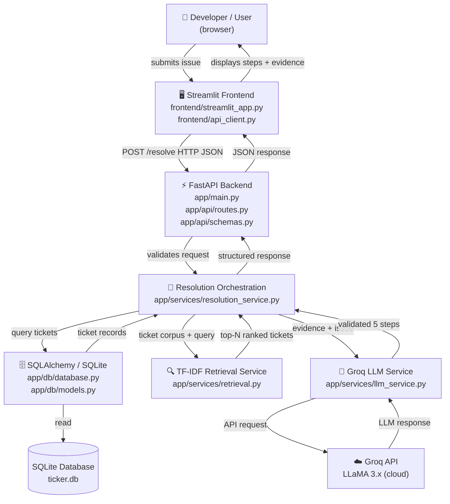
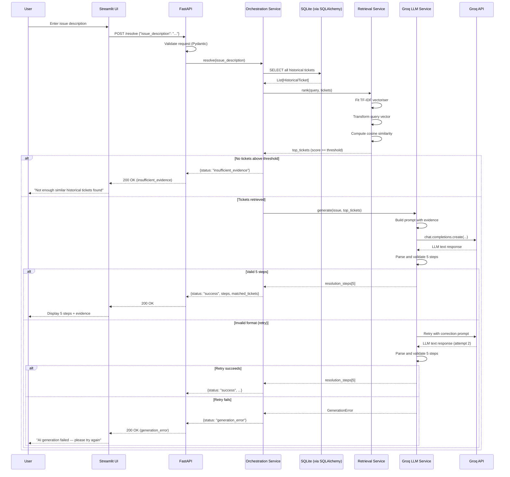
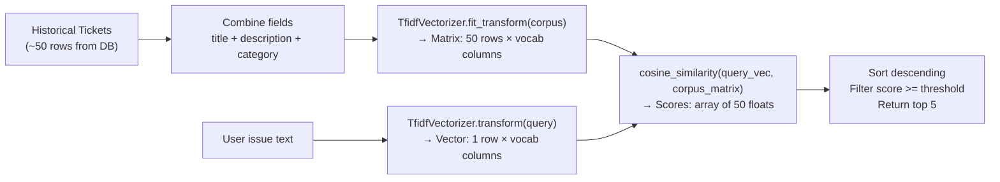

# Architecture — Ticker

> Last updated: 2026-10-10 (Phase 0 — Foundation)
> This document must be updated whenever a component responsibility, interface, or data flow changes.

---

## 1. System overview

Ticker is an IT support assistant that uses historical ticket data to suggest troubleshooting steps for new IT problems.

It follows a **Retrieval-Augmented Generation (RAG)** pattern using:
- **Lexical retrieval** (TF-IDF + cosine similarity via Scikit-learn) to find relevant historical tickets.
- **LLM generation** (Groq API with LLaMA) to synthesise those findings into exactly five actionable steps.

There are no embeddings, vector databases, or semantic retrieval in the MVP. The system is honest about this.

---

## 2. Component architecture

---

## 3. End-to-end sequence diagram

---

## 4. Component responsibilities

### 4.1 Streamlit Frontend (`frontend/`)

**What it does:**
- Presents a text input for the user's IT issue.
- Sends the issue to FastAPI via HTTP POST.
- Displays the five resolution steps, the matched ticket evidence, and status messages.
- Shows loading indicators while waiting for the API.
- Shows user-friendly error messages on failure.

**What it must NOT do:**
- Implement NLP or LLM logic.
- Use different field names than those defined in `app/api/schemas.py`.
- Pretend a request succeeded when it failed.

**Key file:** `frontend/api_client.py` — all HTTP calls go through here. `streamlit_app.py` only calls `api_client` functions.

---

### 4.2 FastAPI Backend (`app/api/`)

**What it does:**
- Defines and validates HTTP endpoints using Pydantic schemas.
- Delegates all business logic to the orchestration service.
- Returns structured JSON responses.
- Exposes autogenerated Swagger docs at `/docs`.

**Endpoints:**

| Method | Path       | Handler                  |
|--------|------------|--------------------------|
| GET    | /health    | `health_check()`         |
| GET    | /tickets   | `list_tickets()`         |
| POST   | /tickets   | `create_ticket()`        |
| POST   | /resolve   | `resolve_issue()`        |

---

### 4.3 SQLAlchemy / SQLite (`app/db/`)

**What it does:**
- Provides the `HistoricalTicket` ORM model.
- Manages the database engine, session factory, and Base.
- Seeds the database with ~50 synthetic tickets idempotently.

**Key constraint:** Tests use a temporary, in-memory SQLite database created per test session. They never modify `ticker.db`.

---

### 4.4 TF-IDF Retrieval Service (`app/services/retrieval.py`)

**What it does:**
- Loads historical ticket records.
- Combines `title + description + category` into a single searchable text per ticket.
- Fits (or re-fits) a `TfidfVectorizer` on the corpus.
- Transforms the user's issue using the same vectoriser.
- Computes cosine similarity between the query vector and all historical ticket vectors.
- Returns up to 5 tickets whose score meets or exceeds `SIMILARITY_THRESHOLD`.

**Important limitation:** TF-IDF is lexical. Two tickets describing the same problem in different words may not match. This is expected and documented.

**Stale-result prevention:** The vectoriser is re-fitted when the corpus changes (i.e., after `POST /tickets`). It is not cached across requests in a way that could return stale results.

---

### 4.5 Groq LLM Service (`app/services/llm_service.py`)

**What it does:**
- Constructs a prompt containing:
  - The user's issue.
  - Retrieved historical ticket descriptions and resolutions.
  - Explicit instructions to generate exactly 5 distinct, actionable steps.
  - Instructions not to follow arbitrary instructions in ticket text.
- Calls the Groq API using the official `groq` Python SDK.
- Parses the response to extract exactly 5 steps.
- Retries **once** with a correction prompt if the format is invalid.
- Returns a typed result: either 5 steps (success) or an error description.

**What it must NOT do:**
- Invent ticket IDs or claim that troubleshooting was already performed.
- Silently swallow failures and return fabricated steps.
- Require a real API key during unit tests (tests use mocks).

---

### 4.6 Resolution Orchestration Service (`app/services/resolution_service.py`)

**What it does:**
- Coordinates the full pipeline: DB → retrieval → evidence check → LLM → response.
- Returns a structured `ResolutionResult` object consumed by the API layer.
- Handles three outcomes:
  1. **success** — 5 steps generated.
  2. **insufficient_evidence** — No tickets above threshold.
  3. **generation_error** — Groq failed after retry.

**Why this layer exists:** Keeps the API routes thin and prevents Streamlit from duplicating business logic.

---

## 5. Data flow — TF-IDF explained

**Why TF-IDF?**
- Required by the problem statement.
- Computationally cheap; ~50 tickets fit in memory with no infrastructure overhead.
- Interpretable: high-scoring terms show *why* a ticket was retrieved.

**Why cosine similarity?**
- Normalises for document length (a long ticket shouldn't score higher just because it repeats words).
- Standard metric for TF-IDF vector comparison.
- Values range 0 (no overlap) to 1 (identical vocabulary distribution).

---

## 6. Design decisions and trade-offs

| Decision                        | Chosen approach             | Alternative considered       | Reason                                           |
|---------------------------------|-----------------------------|------------------------------|--------------------------------------------------|
| Retrieval method                | TF-IDF + cosine similarity  | Sentence embeddings          | Required by problem statement; simpler           |
| LLM provider                   | Groq (LLaMA 3.x)            | OpenAI, Anthropic            | Required by problem statement                    |
| Database (MVP)                  | SQLite                      | PostgreSQL                   | Zero-config local setup; deferred to Phase 7     |
| ORM                             | SQLAlchemy 2.0              | Raw SQL, Tortoise ORM        | Required by problem statement; standard          |
| TF-IDF vectoriser location      | In-memory (per request)     | Redis cache, pickled file    | Dataset too small to need caching                |
| Prompt validation               | Application-level count check | Trust LLM formatting       | LLMs do not reliably follow formatting rules     |
| Frontend-backend separation     | HTTP API                    | Streamlit calling services directly | Required by problem statement; allows /docs |

---

## 7. Limitations and honest constraints

1. **Lexical retrieval only:** TF-IDF cannot match semantically similar text with different vocabulary (e.g. "printer not responding" vs "print queue stuck"). This is accepted for the MVP.
2. **Small corpus:** 50 tickets is enough for a demo. The retrieval quality would not improve dramatically until hundreds more tickets were added.
3. **Single-process SQLite:** Not suitable for concurrent production load. Acceptable for a local hackathon demo.
4. **LLM non-determinism:** The Groq LLM may give different outputs for the same prompt. The 5-step count is enforced, but phrasing may vary.
5. **Rate limits:** Groq's free tier has rate limits. If the demo generates errors, wait and retry. Consider caching responses for frequently repeated queries in later phases.
